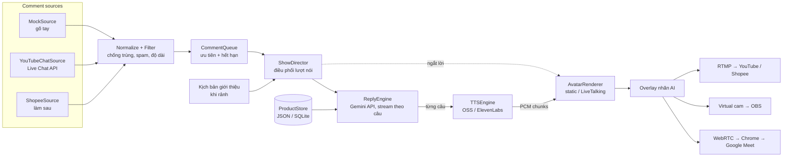
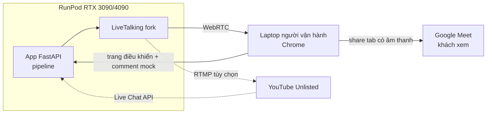

# Kiến trúc: AI Live Shopee

> Cập nhật lần cuối: 2026-10-30. Đây là thiết kế cho giai đoạn Demo; chưa có code.
> Interface dưới đây là bản phác thảo hợp đồng giữa các khâu. Khi code có thể chỉnh, nhưng phải ghi ADR.

## 1. Pipeline tổng quan



**Luồng một comment:**
1. Source nhận comment và chuẩn hóa thành `Comment` (ghi `received_at`).
2. Filter loại spam, comment trùng, quá ngắn hoặc chứa từ cấm, rồi tính điểm ưu tiên và đưa vào queue.
3. `ShowDirector` lấy comment có ưu tiên cao nhất. Nếu avatar đang nói kịch bản rảnh thì dừng ở ranh giới câu gần nhất,
   hoặc chèn câu đệm (ví dụ "Dạ, bạn {author} hỏi về ... ạ") để che độ trễ LLM.
4. `ReplyEngine` truy xuất sản phẩm liên quan và gọi Gemini (ADR-018) ở chế độ streaming. Đủ một câu là đẩy ngay sang TTS.
5. `TTSEngine` trả audio PCM theo chunk; `AvatarRenderer` sinh frame nhép miệng realtime.
6. Overlay ghép nhãn "AI" vào frame, sau đó Output phát đi.

**Hai chế độ chạy:**

| Chế độ | Máy | AvatarRenderer | Output | Dùng khi |
|--------|-----|----------------|--------|----------|
| `static` | Laptop dev (GTX 1650 Ti 4GB) | Ảnh tĩnh + phát audio (có thể nhấp nháy hoặc đổi khung khi đang nói) | Trang web local | Phát triển logic, test |
| `livetalking` | Laptop GTX 1650 Ti 4GB (tạm, chấp nhận chậm, ADR-023); RunPod RTX 3090/4090 là dự phòng | Fork LiveTalking (Wav2Lip; MuseTalk nhiều khả năng không đủ 4 GB) | WebRTC / RTMP | Test lip-sync, demo |

## 2. Mô hình dữ liệu chính

```python
@dataclass(frozen=True)
class Comment:
    id: str
    source: str                 # "mock" | "youtube" | "shopee"
    author: str
    text: str
    received_at: float          # time.monotonic() lúc hệ thống nhận, dùng để đo độ trễ
    platform_ts: datetime | None
    meta: dict[str, Any]

@dataclass
class Product:
    id: str
    name: str
    price: int                  # VND. TODO: có nhiều phân loại / giá theo biến thể không?
    is_primary: bool            # sản phẩm chính của phiên live
    description: str
    specs: dict[str, str]
    faq: list[tuple[str, str]]  # (câu hỏi, câu trả lời) do khách duyệt
    promotions: list[str]
    forbidden_claims: list[str] # các khẳng định không được nói (ví dụ công dụng y tế)
```

## 3. Interface các adapter

Mọi adapter là `typing.Protocol` và được chọn bằng biến môi trường (`COMMENT_SOURCE`, `TTS_PROVIDER`, `AVATAR_MODE`, `OUTPUT_MODE`).
Mã nguồn: `src/ai_live/core/protocols.py`. Bản dưới đây đã cập nhật theo feature 001 (`specs/001-local-reply-pipeline/contracts/adapters.md`).

```python
class CommentSource(Protocol):
    """Nguồn comment. Implementations: MockSource, YouTubeChatSource, ShopeeSource (sau)."""
    name: str
    async def start(self) -> None: ...
    async def stop(self) -> None: ...
    def stream(self) -> AsyncIterator[Comment]: ...   # nguồn kéo về; MockSource dùng push() đồng bộ thay cho stream()

class CommentQueue(Protocol):
    """Hàng đợi ưu tiên. Demo: in-process (asyncio). Nhiều khách: Redis."""
    async def put(self, comment: Comment, priority: Priority) -> None: ...   # Priority là IntEnum, vẫn tương thích int
    async def get(self) -> QueuedComment: ...    # kèm priority, seq; bỏ qua comment đã quá COMMENT_MAX_AGE_S
    def size(self) -> int: ...
    def snapshot(self) -> list[QueuedComment]: ...   # theo thứ tự sẽ lấy, cho trang điều khiển

class ProductStore(Protocol):
    """Dữ liệu sản phẩm nạp từ file Word theo mẫu (ADR-014). Chưa dùng vector DB."""
    @property
    def catalog(self) -> ProductCatalog: ...
    def list_active(self) -> list[Product]: ...
    def get(self, product_id: str) -> Product | None: ...
    def replace(self, data: bytes, source_name: str) -> ProductCatalog: ...   # kiểm xong mới đổi; lỗi thì giữ catalog cũ
    # search(query, limit): chưa làm ở 001 (≤ 4 sản phẩm, đưa hết vào prompt, ADR-005)

class ReplyEngine(Protocol):
    """LLM sinh lời thoại. Yield từng câu hoàn chỉnh để TTS bắt đầu sớm."""
    def reply(self, comment: Comment, catalog: ProductCatalog) -> AsyncIterator[str]: ...
    # narrate(segment_hint, catalog): chưa làm ở 001, thuộc 004-show-director

class TTSEngine(Protocol):
    """TTS tiếng Việt. Implementations: OSS model (TODO: chọn), ElevenLabs, FakeTTS (test)."""
    sample_rate: int            # TODO: thống nhất 16 kHz mono PCM16 theo yêu cầu của lip-sync?
    def synthesize(self, text: str) -> AsyncIterator[bytes]: ...

class AvatarRenderer(Protocol):
    """Biến audio thành hình nhép miệng realtime. Implementations: StaticRenderer, LiveTalkingRenderer."""
    async def start(self) -> None: ...
    async def stop(self) -> None: ...
    async def speak(self, utterance_id: str, text: str, audio: AsyncIterator[bytes], sample_rate: int) -> None: ...
    async def interrupt(self) -> None: ...
    @property
    def is_speaking(self) -> bool: ...
    # Không có trang /host kết nối thì speak() ném RendererUnavailable (ADR-016).

class OutputSink(Protocol):
    """Đích phát. Implementations: WebRTCSink, VirtualCamSink, RtmpSink. Chưa dùng ở 001 (static renderer phát thẳng ra
    trình duyệt); làm ở 005."""
    async def start(self) -> None: ...
    async def stop(self) -> None: ...
    async def write_video(self, frame: "np.ndarray", pts: float) -> None: ...
    async def write_audio(self, pcm: bytes, pts: float) -> None: ...
```

**Ghi chú tích hợp LiveTalking:** LiveTalking có sẵn TTS, WebRTC và RTMP bên trong. Hai cách tích hợp có thể dùng:
- (a) Viết TTS adapter của mình thành plugin TTS bên trong fork LiveTalking, rồi gửi *text* qua HTTP.
- (b) Mình tự làm TTS, sau đó đẩy *PCM audio* vào LiveTalking để nó chỉ làm lip-sync và output.

TODO: Chọn (a) hay (b)? Cần đọc code fork xem có endpoint nhận audio stream không. Nghiêng về (b) để giữ TTS adapter độc lập,
nhưng chưa xác minh. Với `livetalking`, `OutputSink` và overlay nhãn AI có thể phải nằm trong fork thay vì trong repo này.

## 4. Ngân sách độ trễ (mục tiêu < 5 giây)

Đo từ `comment_received` (hệ thống nhận comment) đến `avatar_first_frame` (frame đầu tiên miệng bắt đầu nói ra khỏi output).
Các con số dưới đây là **mục tiêu thiết kế**, chưa đo thực tế.

| Bước | Ngân sách (p95) | Ghi chú |
|------|-----------------|---------|
| Ingest + normalize + filter | 0.2 s | Không tính độ trễ polling của YouTube (xem dưới) |
| Queue → ShowDirector nhận lượt | 0.3 s | Gồm thời gian chờ ngắt câu kịch bản rảnh, hoặc chèn câu đệm |
| LLM đến câu đầu tiên (streaming) | 1.5 s | Prompt ngắn, phần đầu prompt cố định để tận dụng cache; `thinking_level=low`. TODO: benchmark model Gemini nào (spec 001, R5) |
| TTS đến chunk audio đầu tiên | 1.0 s | Phụ thuộc nhà cung cấp; cần TTS hỗ trợ streaming |
| Lip-sync đến frame đầu tiên | 0.8 s | Wav2Lip thường nhanh hơn MuseTalk. TODO: benchmark trên 3090/4090 |
| Encode + mạng (WebRTC) | 0.5 s | RTMP/Shopee có thêm độ trễ phía nền tảng, không tính ở đây |
| **Dự phòng** | 0.7 s | |
| **Tổng** | **≤ 5.0 s** | |

- YouTube Live Chat API trả `pollingIntervalMillis` và comment chỉ tới theo chu kỳ polling. TODO: tiêu chí < 5 giây có tính phần này không?
- Mẹo che độ trễ: câu đệm cố định ("Dạ, câu hỏi hay quá ạ...") có thể được TTS sẵn (chỉ cache audio). Lip-sync vẫn sinh realtime.
  TODO: xác nhận việc cache audio câu đệm không vi phạm quy định "không phát nội dung quay sẵn".

## 5. Ưu tiên comment (bản đầu)

| Ưu tiên | Loại | Ví dụ |
|---------|------|-------|
| Cao | Hỏi giá, khuyến mãi, cách mua, size/biến thể, tồn kho | "Giá bao nhiêu vậy shop?" |
| Trung bình | Hỏi thông số, công dụng, so sánh | "Dùng cho da dầu được không?" |
| Thấp | Chào hỏi, khen | "Chào shop" (có thể gộp nhiều comment để chào một lượt) |
| Bỏ | Spam, link, tục tĩu, comment trùng, quá `COMMENT_MAX_AGE_S` | |

Phân loại ban đầu dùng luật từ khóa (rẻ và nhanh). TODO: có cần LLM phân loại không? Nếu có thì sẽ tốn thêm độ trễ.

## 6. Guardrails cho LLM

- System prompt chỉ cho phép dùng thông tin trong `ProductStore`. Thiếu dữ liệu thì trả lời lịch sự là sẽ để shop phản hồi.
- Câu trả lời ngắn (1–3 câu, nói được trong khoảng 10–15 giây), đúng phong cách xưng hô đã chốt.
- Không nói `forbidden_claims` và không hứa hẹn ngoài dữ liệu.
- Bộ 10 câu hỏi mẫu là regression test cho prompt (`tests/`).

## 7. Độ bền và quan sát

- Mỗi khâu có timeout. Khi TTS hoặc LLM lỗi thì bỏ lượt đó và quay lại kịch bản rảnh; không để avatar đứng im lâu.
- Log có cấu trúc kèm `utterance_id` và các mốc thời gian. Có endpoint `/health` cho từng khâu.
- Watchdog (giai đoạn 2): khởi động lại renderer hoặc output khi mất frame quá N giây.

## 8. Triển khai cho buổi demo



TODO: RunPod có thể không mở được cổng UDP cho WebRTC. Cần thử ngay ở mốc đầu tiên; nếu không được thì dùng TURN qua TCP/TLS
hoặc chuyển sang RTMP/HLS. Xem `RUNPOD.md` và `RISKS.md`.
