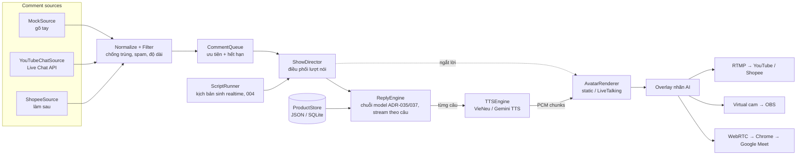
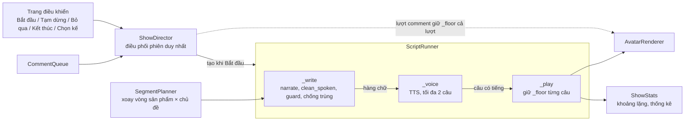
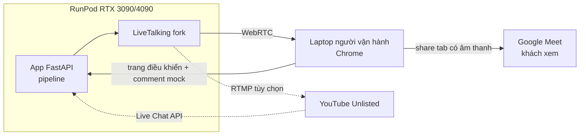

# Kiến trúc: AI Live Shopee

> Cập nhật lần cuối: 2026-11-03. Đây là thiết kế cho giai đoạn Demo. Đã có code của 001 (đường trả lời comment) và 004 (show kịch bản).
> Interface dưới đây là bản phác thảo hợp đồng giữa các khâu. Khi code có thể chỉnh, nhưng phải ghi ADR.

## 1. Pipeline tổng quan



**Luồng một comment:**
1. Source nhận comment và chuẩn hóa thành `Comment` (ghi `received_at`).
2. Filter loại spam, comment trùng, quá ngắn hoặc chứa từ cấm, rồi tính điểm ưu tiên và đưa vào queue.
3. `ShowDirector` lấy comment có ưu tiên cao nhất. Nếu avatar đang nói kịch bản rảnh thì dừng ở ranh giới câu gần nhất,
   hoặc chèn câu đệm (ví dụ "Dạ, bạn {author} hỏi về ... ạ") để che độ trễ LLM.
4. `ReplyEngine` truy xuất sản phẩm liên quan và gọi Gemini (ADR-018) ở chế độ streaming. ADR-035/037 thay bằng chuỗi model free ghim sẵn (`REPLY_ENGINE=chain`, spec 008: SEA-LION qua freellmapi → Qwen3.8 gọi thẳng Groq theo ADR-040, chuyển mục khi lỗi trước câu đầu), đã code (`brain/chain_engine.py`, 2026-11-04; kiểm key + model bằng `GET /models` lúc khởi động, trang điều khiển hiện model đang nói). Số đo độ trễ thật (T055, 2026-11-04, `FakeTTS` + static): câu đầu LLM p95 SEA-LION 1,30 s, gpt-oss-120b 1,72 s, Qwen3.8 1,26 s; khoảng lặng giữa hai câu kịch bản p95 0,016 s, giữa hai phân đoạn p95 0,728 s (lớn nhất 3,578 s khi có giả lập lỗi). Câu chào ≤ 1,64 s khi SEA-LION trả lời; khi SEA-LION hết giờ chờ 3,5 s thì 4,25–4,61 s, 1/5 lần 7,08 s (rủi ro Q18). Vì vậy ADR-040 hạ giờ chờ SEA-LION xuống 2,5 s và bỏ gpt-oss-120b (không đạt SC-001). Chi tiết và số đo lại ở `specs/008-llm-provider-chain/quickstart.md`. Đủ một câu là đẩy ngay sang TTS.
5. `TTSEngine` trả audio PCM16 mono 16 kHz theo chunk (ADR-024, ADR-025, spec 003: `TTS_PROVIDER=vieneu | gemini | fake`;
   máy chạy phiên dùng `vieneu`, Gemini free tier 3 RPM / 10 RPD chỉ để thử);
   `AvatarRenderer` sinh frame nhép miệng realtime.
6. Overlay ghép nhãn "AI" vào frame, sau đó Output phát đi.

**Luồng show kịch bản (feature 004, ADR-026, ADR-032):** nội dung chính của host là kịch bản giới thiệu sản phẩm, sinh realtime.
Đường comment ở trên vẫn chạy, giờ là comment chen vào kịch bản.



1. "Bắt đầu show" → `ShowDirector` tạo `ScriptRunner`. `SegmentPlanner` (logic thuần) chọn phân đoạn kế: `opening`, rồi xoay vòng
   sản phẩm × chủ đề có dữ liệu, cuối cùng `closing`. Người vận hành có thể chọn tay phân đoạn kế (`origin = operator`).
2. `_write` gọi `ReplyEngine.narrate(SegmentRequest)` (ADR-030) cho **một phân đoạn đi trước**: có chữ của N+1 thì chờ N+1 bắt đầu phát
   mới sinh N+2. Mỗi câu qua `clean_spoken()` → `OutputGuard` (ADR-031) → chống lặp nguyên văn rồi vào hàng chữ.
3. `_voice` tạo tiếng theo thứ tự, giữ tối đa `SENTENCE_QUEUE_MAX` câu đã có tiếng. Câu TTS lỗi chỉ bỏ câu đó.
4. `_play` giữ `_floor` cho từng câu, gọi `renderer.speak()`, rồi ghi khoảng lặng (§4). Trước câu đầu của một phân đoạn, kiểm
   `catalog_version`; lệch thì bỏ phân đoạn và sinh lại theo nội dung mới.
5. Comment chen vào: vòng `run()` của 001 bắt đầu lượt trả lời ngay (LLM chạy song song với phần còn lại của câu kịch bản đang nói), tầng
   phát của lượt chờ `_floor`. Sau mỗi câu, `_play` hỏi `InterleaveGate.pending()`; có lượt hoặc comment đang chờ thì nhả `_floor` và
   `wait_clear()`. Tiếng kịch bản đã tạo được giữ qua lượt trả lời. Lời trả lời vào `SpokenHistory` (`source = reply`), không tính xoay vòng.
6. Tạm dừng: nói hết câu đang nói, bỏ tiếng đã tạo mà chưa phát (Điều I), giữ chữ. `SCRIPT_FALLBACK_AFTER` lần `narrate()` lỗi liên tiếp
   → chế độ dự phòng: đọc lần lượt phần giới thiệu và mô tả có sẵn trong file sản phẩm (vẫn qua làm sạch, guard, TTS và renderer
   realtime), trước mỗi phân đoạn dự phòng thử `narrate()` lại, được thì về `normal`. Kết thúc → `closing` (1–2 câu chào) → `ended`; comment lúc
   `closing`/`ended` bị `dropped` với lý do `show_ended`.
7. Mỗi câu kịch bản là một `Utterance` riêng (`utterance_id`, `segment_id`, `show_id`), log mốc `segment_requested` →
   `llm_first_sentence` → `tts_first_chunk` → `avatar_first_frame` vào `script_sentences.jsonl`; tổng hợp show vào
   `show_summary_<show_id>.json`.

**Hai chế độ chạy:**

| Chế độ | Máy | AvatarRenderer | Output | Dùng khi |
|--------|-----|----------------|--------|----------|
| `static` | Laptop dev (GTX 1650 Ti 4GB) | Ảnh tĩnh + phát audio (có thể nhấp nháy hoặc đổi khung khi đang nói) | Trang web local | Phát triển logic, test |
| `livetalking` | Laptop GTX 1650 Ti 4GB (tạm, chấp nhận chậm, ADR-023); RunPod RTX 3090/4090 là dự phòng | Fork LiveTalking (Wav2Lip; MuseTalk nhiều khả năng không đủ 4 GB) | WebRTC / RTMP | Test lip-sync, demo |

## 2. Mô hình dữ liệu chính

```python
@dataclass(frozen=True)
class Comment:
    id: str
    source: str                 # "mock" | "youtube" | "shopee"
    author: str
    text: str
    received_at: float          # time.monotonic() lúc hệ thống nhận, dùng để đo độ trễ
    platform_ts: datetime | None
    meta: dict[str, Any]

@dataclass
class Product:
    id: str
    name: str
    price: int                  # VND. TODO: có nhiều phân loại / giá theo biến thể không?
    is_primary: bool            # sản phẩm chính của phiên live
    description: str
    specs: dict[str, str]
    faq: list[tuple[str, str]]  # (câu hỏi, câu trả lời) do khách duyệt
    promotions: list[str]
    forbidden_claims: list[str] # các khẳng định không được nói (ví dụ công dụng y tế)
```

**Mô hình của show kịch bản (004)** nằm trong `src/ai_live/core/models.py`; bảng đầy đủ ở `specs/004-show-director/data-model.md`.

| Mô hình | Vai trò | Giá trị chính |
|---------|---------|---------------|
| `ShowSession` | Một show, từ "Bắt đầu" tới `ended`; `show_id` mới mỗi lần bắt đầu | `state`: `idle` → `running` ⇄ `paused` → `closing` → `ended`; `mode`: `normal` / `fallback` |
| `Segment` | Một phân đoạn: một sản phẩm × một chủ đề, 3–6 câu (`opening` 2–3, `closing` 1–2) | `topic`: `opening`, `intro`, `highlights`, `specs`, `price`, `promotion`, `faq`, `call_to_action`, `closing`; `origin`: `rotation` / `operator` / `fallback`; `status`: `preparing` → `ready` → `speaking` → `done` (hoặc `skipped`, `failed`, `blocked`, `discarded`) |
| `SegmentRequest` | Đầu vào của `narrate()` | `topic`, `product_id`, `min_sentences`–`max_sentences`, `previous_sentence`, `recent_lines` |
| `ScriptSentence` | Một câu kịch bản; câu được nói có `Utterance` cùng `utterance_id` | `raw_text` (chữ LLM), `text` (sau `clean_spoken()`), `status`: `spoken`, `blocked`, `dropped`, `tts_error`, `render_error`, `interrupted` |
| `SpokenHistory` | Lịch sử đã nói trong một show, cho nối mạch và chống lặp | `source`: `script`, `fallback`, `reply` |
| `SentenceGap` | Khoảng lặng giữa hai câu kịch bản đã nói (§4) | `seconds`, `kind` |

## 3. Interface các adapter

Mọi adapter là `typing.Protocol` và được chọn bằng biến môi trường (`COMMENT_SOURCE`, `REPLY_ENGINE` (`chain | gemini | fake`), `TTS_PROVIDER`, `AVATAR_MODE`, `OUTPUT_MODE`).
Mã nguồn: `src/ai_live/core/protocols.py`. Bản dưới đây đã cập nhật theo feature 001 (`specs/001-local-reply-pipeline/contracts/adapters.md`).

```python
class CommentSource(Protocol):
    """Nguồn comment. Implementations: MockSource, YouTubeChatSource, ShopeeSource (sau)."""
    name: str
    async def start(self) -> None: ...
    async def stop(self) -> None: ...
    def stream(self) -> AsyncIterator[Comment]: ...   # nguồn kéo về; MockSource dùng push() đồng bộ thay cho stream()

class CommentQueue(Protocol):
    """Hàng đợi ưu tiên. Demo: in-process (asyncio). Nhiều khách: Redis."""
    async def put(self, comment: Comment, priority: Priority) -> None: ...   # Priority là IntEnum, vẫn tương thích int
    async def get(self) -> QueuedComment: ...    # kèm priority, seq; bỏ qua comment đã quá COMMENT_MAX_AGE_S
    def size(self) -> int: ...
    def snapshot(self) -> list[QueuedComment]: ...   # theo thứ tự sẽ lấy, cho trang điều khiển

class ProductStore(Protocol):
    """Dữ liệu sản phẩm nạp từ file Word theo mẫu (ADR-014). Chưa dùng vector DB."""
    @property
    def catalog(self) -> ProductCatalog: ...
    def list_active(self) -> list[Product]: ...
    def get(self, product_id: str) -> Product | None: ...
    def replace(self, data: bytes, source_name: str) -> ProductCatalog: ...   # kiểm xong mới đổi; lỗi thì giữ catalog cũ
    # search(query, limit): chưa làm ở 001 (≤ 4 sản phẩm, đưa hết vào prompt, ADR-005)

class ReplyEngine(Protocol):
    """LLM sinh lời thoại. Yield từng câu hoàn chỉnh để TTS bắt đầu sớm."""
    def reply(self, comment: Comment, catalog: ProductCatalog) -> AsyncIterator[str]: ...
    def narrate(self, request: SegmentRequest, catalog: ProductCatalog) -> AsyncIterator[str]: ...
    # narrate(): câu kịch bản của 004 (ADR-030). Lỗi ném ReplyEngineError; engine không tự cắt số câu, ScriptRunner cắt.
    # Câu ra từ reply() và narrate() đều qua clean_spoken() (brain/sanitize.py) rồi OutputGuard. Guard kiểm theo thứ tự
    # forbidden_claim → unknown_amount → unknown_percent → link → platform_phrase → unsupported_claim
    # (ADR-017, mở rộng ở ADR-031 và ADR-050).

class TTSEngineError(RuntimeError):
    """Lỗi ở bước tts (spec 003). kind: quota_exhausted | rate_limited | api_error | config_error | model_error;
    message tiếng Việt, hiện nguyên văn cho người vận hành."""

class TTSEngine(Protocol):
    """TTS tiếng Việt (ADR-024). Implementations: VieneuTTS (chạy CPU trên máy), GeminiTTS (gói miễn phí), FakeTTS (test).
    create_tts() luôn bọc engine trong SpeechTTS: chuẩn hóa chữ trước khi đọc, đếm ký tự, nghỉ sau lỗi hết hạn mức."""
    sample_rate: int            # PCM16 little-endian, mono, đúng 16000 Hz (ADR-025); adapter tự hạ tần số nguồn
    async def warm_up(self) -> None: ...   # nạp model trước phiên; lỗi ném TTSEngineError("config_error"), app vẫn chạy
    def synthesize(self, text: str) -> AsyncIterator[bytes]: ...   # lỗi ném TTSEngineError

class AvatarRenderer(Protocol):
    """Biến audio thành hình nhép miệng realtime. Implementations: StaticRenderer, LiveTalkingRenderer."""
    async def start(self) -> None: ...
    async def stop(self) -> None: ...
    async def speak(self, utterance_id: str, text: str, audio: AsyncIterator[bytes], sample_rate: int) -> None: ...
    async def interrupt(self) -> None: ...
    @property
    def is_speaking(self) -> bool: ...
    # Không có trang /host kết nối thì speak() ném RendererUnavailable (ADR-016).

class OutputSink(Protocol):
    """Đích phát. Implementations: WebRTCSink, VirtualCamSink, RtmpSink. Chưa dùng ở 001 (static renderer phát thẳng ra
    trình duyệt); làm ở 005."""
    async def start(self) -> None: ...
    async def stop(self) -> None: ...
    async def write_video(self, frame: "np.ndarray", pts: float) -> None: ...
    async def write_audio(self, pcm: bytes, pts: float) -> None: ...
```

**Ghi chú tích hợp LiveTalking:** LiveTalking có sẵn TTS, WebRTC và RTMP bên trong. Hai cách tích hợp có thể dùng:
- (a) Viết TTS adapter của mình thành plugin TTS bên trong fork LiveTalking, rồi gửi *text* qua HTTP.
- (b) Mình tự làm TTS, sau đó đẩy *PCM audio* vào LiveTalking để nó chỉ làm lip-sync và output.

Đã chốt (b) (ADR-042, ADR-043): app đẩy PCM qua WebSocket `/ailive/ws` của fork, fork chỉ làm lip-sync và phát WebRTC tới `/host`.
Với `livetalking`, nhãn AI vẽ trong khung hình của fork (ADR-044).

## 4. Ngân sách độ trễ (mục tiêu < 5 giây)

> Hiến pháp 1.2.0 Điều VI (ADR-029): bảng dưới áp dụng cho câu trả lời comment. Show kịch bản (feature 004) đo riêng: từ lúc bấm
> "Bắt đầu" đến câu đầu phát ra ≤ 5 giây; khoảng lặng giữa hai câu p95 ≤ 1,5 giây, không lần nào > 5 giây. Câu kịch bản dùng mốc
> `segment_requested` thay cho `comment_received`.

Đo từ `comment_received` (hệ thống nhận comment) đến `avatar_first_frame` (frame đầu tiên miệng bắt đầu nói ra khỏi output).
Các con số dưới đây là **mục tiêu thiết kế**, chưa đo thực tế.

| Bước | Ngân sách (p95) | Ghi chú |
|------|-----------------|---------|
| Ingest + normalize + filter | 0.2 s | Không tính độ trễ polling của YouTube (xem dưới) |
| Queue → ShowDirector nhận lượt | 0.3 s | Gồm thời gian chờ ngắt câu kịch bản rảnh, hoặc chèn câu đệm |
| LLM đến câu đầu tiên (streaming) | 1.5 s | Prompt ngắn, phần đầu prompt cố định để tận dụng cache; `thinking_level=low`. TODO: benchmark model Gemini nào (spec 001, R5) |
| TTS đến chunk audio đầu tiên | 1.0 s | Phụ thuộc nhà cung cấp; cần TTS hỗ trợ streaming |
| Lip-sync đến frame đầu tiên | 0.8 s | Wav2Lip thường nhanh hơn MuseTalk. Laptop 1650 Ti đo 0,92–1,16 s (005 T046, chấp nhận theo ADR-023). TODO: benchmark trên 3090/4090 |
| Encode + mạng (WebRTC) | 0.5 s | RTMP/Shopee có thêm độ trễ phía nền tảng, không tính ở đây |
| **Dự phòng** | 0.7 s | |
| **Tổng** | **≤ 5.0 s** | |

**Đo show kịch bản (004, research R12):** dùng đúng các ack của trang host đã có (ADR-016), không ước từ thời lượng audio (sai khi
trình duyệt đệm hoặc tab bị nền).

- **Khoảng lặng** giữa hai câu kịch bản đã nói: `gap = avatar_first_frame(câu N+1) − played_at(câu N)`. `played_at` là lúc
  `renderer.speak()` trả về, tức khi trang host đã ack câu N phát xong. `ScriptRunner._play` ghi mỗi gap vào `ShowStats` và log
  `sentence_gap` kèm nhãn:

  | Nhãn | Khi nào | Tính vào SC-002 (p95 ≤ 1,5 s, không lần nào > 5 s) |
  |------|---------|-----------------------------------------------------|
  | `script` | Hai câu liền nhau trong cùng phân đoạn | Có |
  | `segment_boundary` | Câu cuối phân đoạn N và câu đầu N+1 | Có |
  | `error` | Có lỗi thật xen giữa (người xem vẫn nghe thấy im lặng) | Có |
  | `fault` | Có lỗi giả lập xen giữa | Không; kiểm riêng ≤ 8 s cho SC-006 |
  | `comment` | Có lượt trả lời comment xen giữa | Không; SC-011 đo riêng |
  | `paused` | Người vận hành tạm dừng xen giữa | Không |

  `ShowStats` tính trung vị, p95 (cần ≥ 20 mẫu, dùng chung `director/latency.step_stats` với 001) và giá trị lớn nhất theo từng nhãn,
  ghi vào `show_summary_<show_id>.json`. Câu đầu tiên của show không có gap.
- **Bắt đầu → câu đầu** (SC-001): `avatar_first_frame` của câu đầu phân đoạn `opening` trừ lúc server nhận `POST /api/show/start`,
  ghi là `show_first_sentence_s`.
- Câu kịch bản không vào `LatencyTracker` của comment, nên bảng độ trễ comment ở trên giữ nguyên ý nghĩa.

- YouTube Live Chat API trả `pollingIntervalMillis` và comment chỉ tới theo chu kỳ polling. TODO: tiêu chí < 5 giây có tính phần này không?
- Mẹo che độ trễ: câu đệm cố định ("Dạ, câu hỏi hay quá ạ...") có thể được TTS sẵn (chỉ cache audio). Lip-sync vẫn sinh realtime.
  TODO: xác nhận việc cache audio câu đệm không vi phạm quy định "không phát nội dung quay sẵn".

## 5. Ưu tiên comment (bản đầu)

| Ưu tiên | Loại | Ví dụ |
|---------|------|-------|
| Cao | Hỏi giá, khuyến mãi, cách mua, size/biến thể, tồn kho | "Giá bao nhiêu vậy shop?" |
| Trung bình | Hỏi thông số, công dụng, so sánh | "Dùng cho da dầu được không?" |
| Thấp | Chào hỏi, khen | "Chào shop" (có thể gộp nhiều comment để chào một lượt) |
| Bỏ | Spam, link, tục tĩu, comment trùng, quá `COMMENT_MAX_AGE_S` | |

Phân loại ban đầu dùng luật từ khóa (rẻ và nhanh). TODO: có cần LLM phân loại không? Nếu có thì sẽ tốn thêm độ trễ.

## 6. Guardrails cho LLM

- System prompt chỉ cho phép dùng thông tin trong `ProductStore`. Thiếu dữ liệu thì trả lời lịch sự là sẽ để shop phản hồi.
- Câu trả lời ngắn (1–3 câu, nói được trong khoảng 10–15 giây), đúng phong cách xưng hô đã chốt.
- Không nói `forbidden_claims` và không hứa hẹn ngoài dữ liệu.
- Bộ 10 câu hỏi mẫu là regression test cho prompt (`tests/`).

## 7. Độ bền và quan sát

- Mỗi khâu có timeout. Khi TTS hoặc LLM lỗi thì bỏ lượt đó và quay lại kịch bản rảnh; không để avatar đứng im lâu.
- Log có cấu trúc kèm `utterance_id` và các mốc thời gian. Có endpoint `/health` cho từng khâu.
- Watchdog (giai đoạn 2): khởi động lại renderer hoặc output khi mất frame quá N giây.

## 8. Triển khai cho buổi demo



TODO: RunPod có thể không mở được cổng UDP cho WebRTC. Cần thử ngay ở mốc đầu tiên; nếu không được thì dùng TURN qua TCP/TLS
hoặc chuyển sang RTMP/HLS. Xem `RUNPOD.md` và `RISKS.md`.
