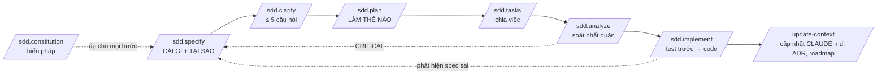

# Quy trình làm việc với AI: Spec-Driven Development

> Dựa trên [github/spec-kit](https://github.com/github/spec-kit). Dự án dùng **bản tự dựng** bằng các lệnh `/sdd.*`
> (không cài CLI `specify`) để gắn với bộ docs sẵn có. Lý do ở ADR-013.
> Nguyên tắc cốt lõi: **spec là nguồn sự thật, code phục vụ spec.** Muốn đổi hành vi thì sửa spec trước, rồi mới sửa code.

## 1. Luồng chuẩn cho một tính năng

| Bước | Lệnh | Đầu ra | Người dùng cần làm |
|------|------|--------|---------------------|
| 0 | `/sdd.constitution` | `.specify/memory/constitution.md` | Duyệt khi có thay đổi (hiếm) |
| 1 | `/sdd.specify <mô tả>` | `specs/NNN-slug/spec.md` (+ branch nếu có git) | Đọc spec: đúng ý chưa, đúng phạm vi chưa |
| 2 | `/sdd.clarify` | spec được cập nhật, có mục "Làm rõ" | Trả lời tối đa 5 câu |
| 3 | `/sdd.plan [ghi chú kỹ thuật]` | `plan.md`, `research.md`, `data-model.md`, `contracts/`, `quickstart.md` | **Duyệt dependency mới và ADR đề xuất** |
| 4 | `/sdd.tasks` | `tasks.md` | Xem phạm vi MVP |
| 5 | `/sdd.analyze` | Báo cáo (không sửa file) | Quyết định sửa hay bỏ qua từng vấn đề |
| 6 | `/sdd.implement [US1 \| T001-T010]` | Code + test, tasks được đánh dấu `[x]` | Kiểm chứng ở mỗi checkpoint |
| 6′ | `/sdd.dispatch [US3 \| T071-T079]` | Như bước 6, nhưng chia task cho các sub-agent `ai-*` chạy song song (mục 2b) | Như bước 6 |
| 7 | `/update-context` | `CLAUDE.md`, `DECISIONS.md`, `ROADMAP.md` | Đọc tóm tắt |

**Quy tắc vàng:** mỗi bước kết thúc bằng **dừng lại để người dùng duyệt**. AI không tự chạy bước sau.

## 2. Khi nào được đi đường tắt

| Loại việc | Quy trình |
|-----------|-----------|
| Tính năng mới, hành vi người dùng thấy được, thay đổi pipeline hay interface adapter, thêm dependency/hạ tầng | **Đủ 7 bước** |
| Mở rộng nhỏ trong một feature đang làm | Sửa `spec.md` và `tasks.md` của feature đó, rồi `/sdd.implement` |
| Sửa bug | Viết test tái hiện (phải FAIL), sửa, chạy test. Nếu bug do spec sai thì sửa spec. Không cần spec mới |
| Refactor nội bộ không đổi hành vi, sửa docs, chỉnh cấu hình | Làm trực tiếp, test phải xanh |
| Thí nghiệm hoặc benchmark (ví dụ Wav2Lip vs MuseTalk) | Làm trong `scripts/` hoặc branch nháp; kết quả ghi `research.md` hoặc ADR. Không merge code thí nghiệm vào `src/` khi chưa có spec |

## 2b. Chạy song song bằng sub-agent

`/sdd.dispatch` thay cho `/sdd.implement` khi một phase có nhiều task độc lập. Mỗi sub-agent (`.claude/agents/`) giữ một nhóm khâu
luôn đi liền nhau, chỉ được sửa file của mình, nên các agent chạy cùng lúc mà không phải chờ nhau. Luật chung nằm ở
`.claude/agent-rules.md`.

| Agent | Luồng | File sở hữu chính |
|-------|-------|-------------------|
| `ai-comments` | Nguồn comment → lọc → phân loại ưu tiên → hàng đợi | `comments/`, `comment_queue/`, `data/rules/` |
| `ai-brain` | Nội dung sản phẩm → prompt → ReplyEngine → OutputGuard → bộ chấm | `products/`, `brain/`, `qa_eval/` |
| `ai-media` | TTS → AvatarRenderer → trang host có nhãn AI | `tts/`, `avatar/`, `static/host.*`, `scripts/runpod/` |
| `ai-orchestrator` | Lõi dùng chung và phần nối: `core/`, ShowDirector, độ trễ, API, WebSocket, trang điều khiển | `core/`, `director/`, `app/` |
| `ai-qa` | Kiểm độ phủ test, contract test cho adapter, bộ câu hỏi chấm, chạy kiểm toàn bộ cuối mỗi đợt | `tests/contract/`, `data/eval/`, fixture dùng chung |

- Agent cần sửa file không thuộc mình thì không sửa, mà ghi vào mục **Handoff** của báo cáo; phiên chính chuyển sang agent chủ ở đợt sau.
- Chỉ phiên chính tick `tasks.md` và sửa `docs/`. Khi mọi agent trong đợt đã báo cáo, phiên chính gọi `ai-qa` ở chế độ
  `wave-check` để chạy toàn bộ `pytest` + `ruff`. Task chỉ được tick khi kết quả xanh.
- Quy tắc vàng vẫn giữ: `/sdd.dispatch` dừng ở checkpoint của phase như `/sdd.implement`.
- Chưa dùng `isolation: worktree` vì repo chưa có commit nào (worktree sẽ rỗng). TODO: sau commit đầu tiên, có nên chạy agent trong worktree riêng không?

## 3. Quy ước

- **Feature ID:** `NNN-slug`, ví dụ `001-local-reply-pipeline`. Đánh số tăng dần, slug tiếng Anh kebab-case. Branch git trùng tên.
- **Trạng thái spec:** `Draft → Clarified → Planned → Tasked → In progress → Done`. Ghi ở đầu `spec.md` và trong `specs/README.md`.
- **Đánh dấu chưa rõ:** trong spec dùng `[NEEDS CLARIFICATION: câu hỏi]`; ở các doc khác dùng `TODO: câu hỏi`.
- **Định danh trong spec:** user story `US1..`, yêu cầu `FR-001..`, tiêu chí `SC-001..`, task `T001..`.
- **Đánh dấu task:** `[P]` chạy song song được, `[GPU]` cần RunPod, `[US#]` thuộc story nào. `[x]` là xong, `[~]` là chờ GPU.
- **Việc GPU:** gom các task `[GPU]` của nhiều feature để bật RunPod một lần (`docs/RUNPOD.md`).
- **Ngôn ngữ (ADR-022):** spec, plan và tasks viết tiếng Việt. Tên file, ID, định danh, comment và docstring trong code dùng tiếng Anh.
  File context AI (`CLAUDE.md`, `.claude/commands/`, hiến pháp) viết tiếng Anh.

## 4. Quan hệ với các tài liệu khác

| Tài liệu | Vai trò trong flow |
|----------|--------------------|
| `.specify/memory/constitution.md` | Luật cao nhất, được kiểm ở cổng của `/sdd.plan` và trong `/sdd.analyze` |
| `docs/PRD.md` | Phạm vi sản phẩm; mỗi spec là một lát cắt của PRD |
| `docs/ROADMAP.md` | Mỗi feature gắn với một mốc (M1a, M1b...) |
| `docs/ARCHITECTURE.md` | Interface chung; `contracts/` của feature phải khớp hoặc đề xuất ADR để đổi |
| `docs/DECISIONS.md` | `/sdd.plan` thêm ADR `Đề xuất`; người dùng duyệt thì chuyển `Đã chốt` |
| `docs/RISKS.md` | `/sdd.plan` thêm rủi ro mới |
| `specs/README.md` | Danh mục feature và trạng thái |

## 5. Nếu muốn chuyển sang spec-kit CLI chính thức

Bố cục thư mục (`.specify/memory`, `.specify/templates`, `specs/NNN-slug/`) đã theo spec-kit. Nếu sau này cài CLI chính thức
(`uv tool install specify-cli`, rồi `specify init --here` với integration cho Claude Code):
- Sao lưu `.specify/` và `.claude/commands/` trước, vì `init` có thể ghi đè template và hiến pháp.
- TODO: kiểm tra lệnh `init` chính xác và các file nó tạo trước khi chạy trong repo này (lần thử trước chưa chạy được CLI).
